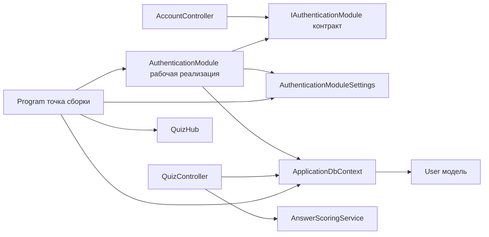

# Карта модулей Quizzy

Карта отражает исходный код на дату подготовки практической работы. Стрелка означает направление зависимости исходного кода или вызова, а не поток данных.

| Модуль / часть | Ответственность и публичная граница | Основные зависимости | Расположение | Статус и автор записи карты |
|---|---|---|---|---|
| Регистрация и вход | `IAuthenticationModule`: регистрация, проверка учётных данных, типизированные исходы | Контракт не зависит от инфраструктуры | `QuizMvp/Authentication/IAuthenticationModule.cs` | Реализован в этой работе; Егор Голубев |
| Реализация регистрации и входа | Работа с пользователями, проверка имени и хеша пароля | Контракт, `AuthenticationModuleSettings`, EF Core `ApplicationDbContext`, `User` | `QuizMvp/Services/AuthenticationModule.cs` | Рабочая реализация; Егор Голубев |
| Веб-слой аккаунта | Получает формы, вызывает контракт, преобразует исход в представление/перенаправление и управляет сессией | Только `IAuthenticationModule` для сценариев регистрации и входа | `QuizMvp/Controllers/AccountController.cs` | Реализован; Егор Голубев |
| Сборка приложения | Регистрирует реализации в DI и собирает HTTP pipeline | Контроллеры, БД, настройки, SignalR | `QuizMvp/Program.cs` | Сборочная точка |
| Квизы и оценивание ответов | Обработка HTTP-сценариев квиза и начисление баллов | `ApplicationDbContext`, модели, `AnswerScoringService` | `QuizMvp/Controllers/QuizController.cs`, `QuizMvp/Services/AnswerScoringService.cs` | Существующий контур |
| Хранение | EF Core-контекст и модель пользователя | SQLite через конфигурацию приложения | `QuizMvp/Data/ApplicationDbContext.cs`, `QuizMvp/Models/User.cs` | Общая инфраструктура |

## Проверка направлений

В `AccountController.cs` используется только пространство имён контракта; прямой зависимости от `ApplicationDbContext`, EF Core или `User` нет. Реализация подключается в `Program.cs`. В просмотренных зависимостях цикла модулей регистрации не обнаружено.
